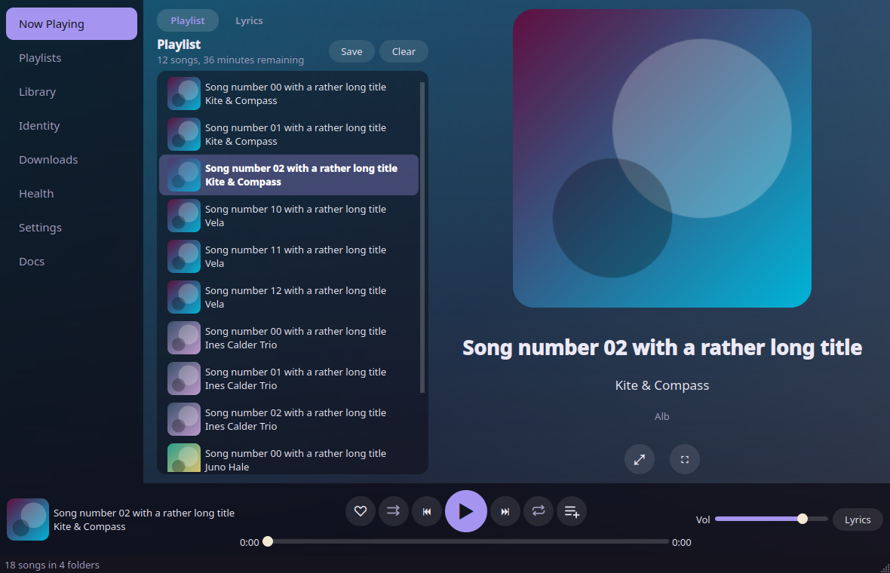
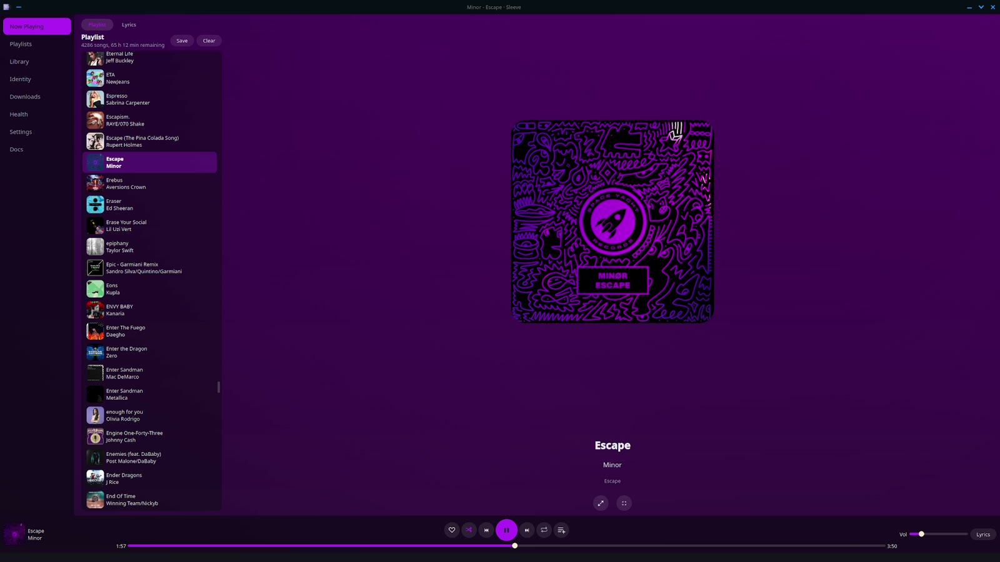
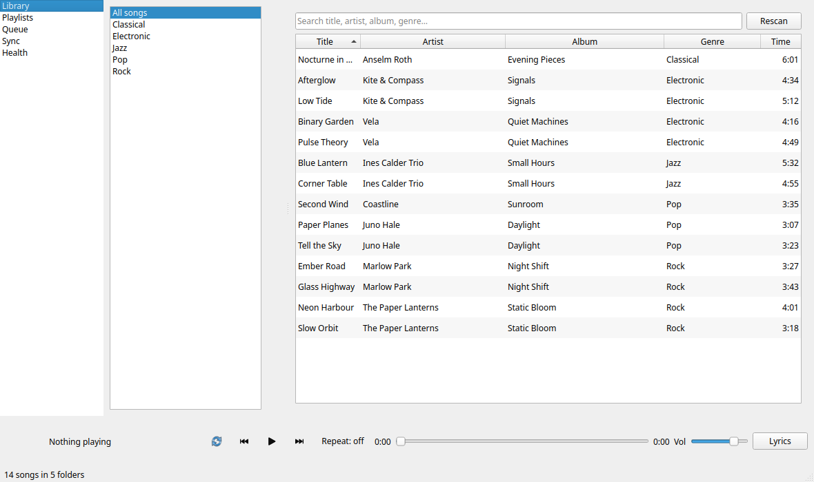
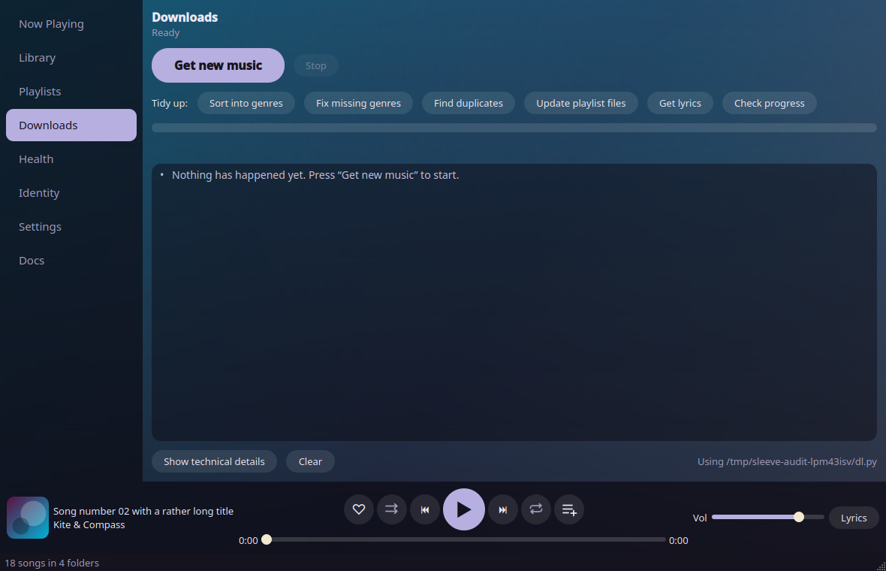
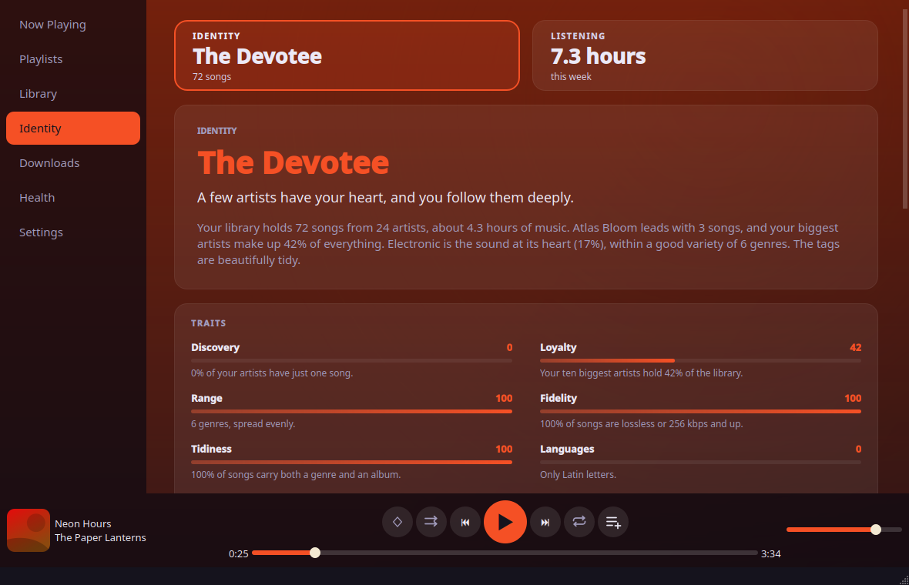
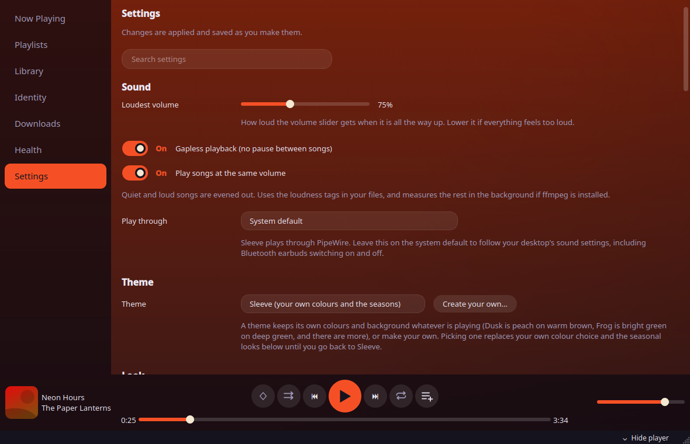

# Sleeve

**A desktop music player and library manager for the music you own.**

[](https://github.com/jieke238y34/sleeve/actions/workflows/ci.yml)
[](LICENSE)


Sleeve plays, organises and edits the music files you already have. It needs no accounts and sends no telemetry. It
uses the internet only when you ask it to: for the optional tag lookup on MusicBrainz, and when `dl.py` downloads.

[playlist-sync](https://github.com/jieke238y34/playlist-sync) (`dl.py`) is a separate open source tool that downloads
music from your Spotify playlists. Sleeve's Downloads page can run it for you, and walks you through setting it up. You
only need it for that page: without it Sleeve is a complete player and library manager for a folder of music.



> **Status: alpha (v0.2.0).** Linux is the supported platform. Back up your music before using the tag editor, and
> please report anything odd. Much of the code was written with an AI coding assistant under the author's direction,
> and is covered by automated tests, linting and security scanning.

## Showcase

[](docs/media/sleeve-showcase.mp4)

A short tour of the Now Playing page, the Library, Identity, Downloads and Settings, recorded on a real library. The video
has no sound.

## Screenshots

The screenshots show a small made-up demo library with generated covers.

| | |
|---|---|
|  |  |
| Library: genre folders, search and a sortable table | Downloads: the optional front end for dl.py |
|  |  |
| Identity: your library in words and numbers | Settings: sound, accent colour and file locations |

## Features

**Library**

- Genre folders, instant search across title, artist, album and genre, a sortable song table and an album grid of
  covers. Ctrl+K searches songs, playlists and folders at once. Tags are cached, so a large library opens quickly.
- Tag editor for title, artist, album and genre. This is the only thing Sleeve writes into your music files, and
  only when you press Save.
- Health page: missing title or artist, no genre, low bitrate, same artist and title, and files `dl.py` parked as
  duplicates or broken, with buttons to play, show in the file manager, or run the matching `dl.py` fix.
- Identity page: a persona, seven trait meters, charts, languages and moods, all worked out from your own tags and
  playlist names.

**Playback**

- Gapless playback through Qt Multimedia, with a queue, shuffle, repeat and seeking. No external player is needed.
- Same-volume levelling from ReplayGain tags, or measured with `ffmpeg` when it is installed, and a volume ceiling
  setting that can go up to 150% (with a hearing warning).
- Media keys and the Plasma and GNOME media widgets (MPRIS).
- Now Playing: the cover with a gradient background drawn from its colours, the queue with thumbnails, and a cover you
  can expand. Fullscreen album art (Esc or a click to leave).
- Lyrics tab: synced lyrics from `.lrc` files scroll with the song and can be clicked to seek, plain `.txt` lyrics are
  shown unsynced, and the tab says "No imported lyrics found" otherwise.
- The small cover in the player bar opens Now Playing with one click.

**Playlists**

- Liked songs, kept in Sleeve's own file.
- Playlists of your own, stored as plain `.m3u8` files in `Playlists/My Playlists`: create, rename, reorder, add songs
  from the Library, add the playing song with the player-bar button, and save the queue.
- Import `.m3u8` files by dragging them onto the Playlists page. Songs are matched by path, then by file name.
- Playlists that `dl.py` made from Spotify are hidden until you ask for them, and can be copied into playlists of
  your own.

**Downloads (optional)**

- A front end for `dl.py`: get new music, sort into genres, fix missing genres, find duplicates, rebuild playlist
  files, fetch lyrics and check progress, with a plain-English activity feed. Only this page needs `dl.py`.
- Sleeve asks you to trust `dl.py` before it runs it (see [First run](#first-run)).

**Appearance**

- Sixteen bold accent colours plus any colour you choose, or let the accent follow the song's cover. Switches for
  settings, a resizable sidebar, smooth scrolling.

## Install

Sleeve is built from source on your own machine, so you need only Python 3.10 or newer and `git`. One command does it all:
it makes a private Python environment, builds and installs Sleeve into it, adds a `sleeve` command, and puts Sleeve in
your application menu with its icon. It needs no root access and changes nothing outside your home folder.

```sh
git clone https://github.com/jieke238y34/sleeve.git
cd sleeve
./install.sh
```

Then start **Sleeve** from your application menu, or run `sleeve`. The first install downloads Qt (about 200 MB).

To update, run `git pull` and `./install.sh` again. To remove it, run `./install.sh --uninstall`. Your music, playlists
and settings (`~/.config/sleeve`) are never touched.

Prefer not to clone first? This does the same from the web (read the script before you run it, as with any script):

```sh
curl -fsSL https://raw.githubusercontent.com/jieke238y34/sleeve/main/install.sh | sh
```

**Optional extras** (the installer tells you which are missing and how to get them):

| Tool | What it adds | Fedora | Debian / Ubuntu |
|---|---|---|---|
| `pactl` | Volume above 100% | `sudo dnf install pulseaudio-utils` | `sudo apt install pulseaudio-utils` |
| `ffmpeg` | Same-volume playback for files without ReplayGain tags | `sudo dnf install ffmpeg-free` | `sudo apt install ffmpeg` |

**Developing Sleeve?**

```sh
git clone https://github.com/jieke238y34/sleeve.git && cd sleeve
python -m venv .venv && . .venv/bin/activate
pip install -e ".[dev]"
sleeve
```

The full guide, including other ways to install, is [docs/INSTALL.md](docs/INSTALL.md).

## First run

The first time you start Sleeve it asks which folder holds your music (you can change this later in Settings). That is
all it needs to play. Double-click a song to play it. Space pauses and resumes. Press **Ctrl+K** to search everything.

**Downloads (optional).** On the Downloads page, **Get dl.py for me** downloads [playlist-sync](https://github.com/jieke238y34/playlist-sync)
(`dl.py`) from GitHub into Sleeve's own folder (it asks first; you need `git`). Then **Set up…** helps you choose the music folder and paste your Spotify playlist links. Sleeve finds
`dl.py` on its own, or you can point to it with `sleeve --dl /path/to/dl.py`.

**Trust.** The first time you press a Downloads button, Sleeve shows the path and a SHA-256 fingerprint of `dl.py` and
asks whether to trust it. Say yes only if you wrote the script or have read it. Sleeve asks again if the script's path
or content changes. If you say no, nothing is run.

## Requirements

- Linux with Python 3.10 or newer. PySide6 (6.6 or newer) and mutagen are installed for you.
- `git`, to fetch and update the source.
- PipeWire (or PulseAudio) for sound output. It is already there on current Fedora, Ubuntu and most other desktops.
- `ffmpeg` and `pactl` (both optional, see above).
- `mpv` is **not** needed. Playback uses Qt Multimedia.
- [playlist-sync](https://github.com/jieke238y34/playlist-sync) (optional): only for the Downloads page.

## How Sleeve and dl.py fit together

They are separate programs. Sleeve never imports `dl.py`. When you press a Downloads button it starts `dl.py` as a
child process, using the same Python that runs Sleeve, with one of a fixed list of arguments. No text from the
interface, from file names or from tags is passed to it, and no shell is used. Sleeve follows `dl.py`'s log to show
progress.

## Privacy and safety

- No accounts and no telemetry. Sleeve makes no network calls on its own. The internet is only used when `dl.py`
  downloads music for you, and when you press **Find tags online** on the Health page: that sends the title and artist
  (or file name) of the chosen songs to [MusicBrainz](https://musicbrainz.org), one song a second, after you agree.
  Nothing is written to your files until you review the results. **Get dl.py for me** downloads playlist-sync from
  GitHub, also only after you agree.
- It writes only the tags you save yourself, plus its own files: `~/.config/sleeve` (settings, likes, the `dl.py`
  trust record) and `~/.cache/sleeve` (tag cache and loudness results). Playlists you make are `.m3u8` files in
  `Playlists/My Playlists`. If `XDG_CONFIG_HOME` or `XDG_CACHE_HOME` is set, those folders are used instead.
- Only validated audio files are handed to the player. Playlists, lyrics and tags are treated as untrusted data.

Details and how to report a vulnerability are in [SECURITY.md](SECURITY.md).

## Keyboard shortcuts

| Key | Action |
|---|---|
| Space | Play or pause |
| Left / Right arrow | Back or forward 5 seconds |
| Ctrl+K | Search everything: songs, playlists and folders |
| F11 | Fullscreen album art |
| Esc | Leave fullscreen |
| Media keys | Play, pause, next, previous |

When a text box, list or button has focus, Space and the arrows keep their normal job there.

**From a terminal, a shortcut or a launcher:** `sleeve --play-pause`, `sleeve --next`, `sleeve --previous` and
`sleeve --toggle` control the Sleeve that is already open. Right-clicking Sleeve in the menu offers the same.

## Works with

- **KDE Connect:** pair your phone and turn on its "Multimedia control" plugin. Sleeve appears in the phone's media
  remote. The Plasma media widget and lock screen controls work too.
- **[PlasMusic Toolbar](https://github.com/ccatterina/plasmusic-toolbar):** pick Sleeve as its source for title, cover,
  seek bar and controls in your panel.
- **[Maid BT](https://github.com/Maidware-Project/Maid-BT):** if installed, Settings gets earbuds buttons, and Sleeve
  follows the sound when the earbuds switch.
- **Discord and [arRPC](https://arrpc.openasar.dev/):** optional "Listening to" status for Discord, Vesktop and other
  clients. Off until you switch it on in Settings and add your own Discord Application ID. It can show the album cover too
  (a separate switch: the cover address comes from MusicBrainz and the Cover Art Archive).
- **PipeWire:** Sleeve follows your desktop's output, and Settings can pick a specific one.

All of this goes through MPRIS (track information and controls) and PipeWire (the sound itself).

## Troubleshooting

- **The Library is empty:** check the music folder shown on the Settings page, then press Rescan.
- **Nothing happens on Downloads:** you may have answered no to the trust prompt. Run the action again and say yes.
- **Media keys do nothing:** they need a desktop with MPRIS support, such as KDE Plasma or GNOME.
- **Volume above 100% does nothing:** it needs `pactl` (see Install).
- **No sound:** check your output device (Settings > Play through), and run `sleeve` from a terminal to see Qt's messages.
- **`sleeve: command not found` after installing:** add `~/.local/bin` to your PATH, or use the menu entry.

More in the [user guide](docs/USER_GUIDE.md).

## Development

```sh
pip install -e ".[dev]"
pytest                                   # tests (run headless)
ruff check .                             # lint
bandit -q -r sleeve -c pyproject.toml    # security lint
python tools/ui_audit.py --demo          # render every page and check the layout
```

See [CONTRIBUTING.md](CONTRIBUTING.md), [docs/ARCHITECTURE.md](docs/ARCHITECTURE.md) and
[docs/TESTING.md](docs/TESTING.md).

## Roadmap and not yet

These are not in v0.2.0:

- A tag editor for the Health page's problems (today it shows them and starts the matching `dl.py` job).
- A Windows build and installer.
- A Fedora package (the RPM spec is in [packaging/](packaging/README.md) but nothing is published).
- Publishing to PyPI.

No dates are promised.

## Documentation

- [Installing](docs/INSTALL.md) and the [user guide](docs/USER_GUIDE.md)
- [Architecture](docs/ARCHITECTURE.md), [testing](docs/TESTING.md) and [releasing](docs/RELEASING.md)
- [Changelog](CHANGELOG.md), [security policy](SECURITY.md) and [contributing](CONTRIBUTING.md)
- [Packaging status](packaging/README.md)

## Licence

Sleeve is free software under the GPL-3.0-or-later. See [LICENSE](LICENSE). Third-party components and their licences are
listed in [THIRD_PARTY_NOTICES.md](THIRD_PARTY_NOTICES.md).
