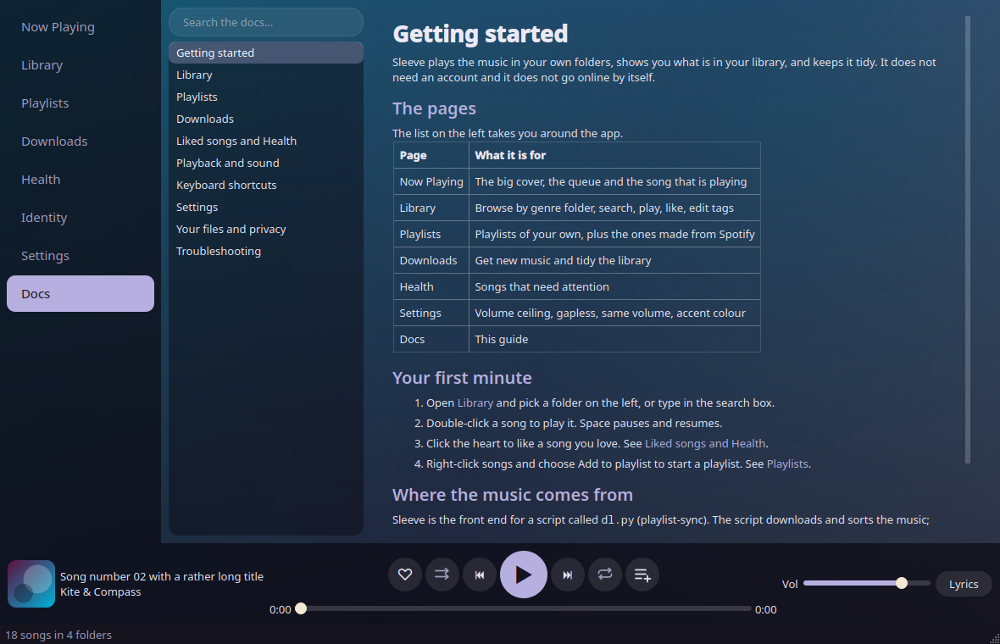

# Sleeve

**A desktop music player and library manager for the music you own.**

[](https://github.com/jieke238y34/sleeve/actions/workflows/ci.yml)
[](LICENSE)


Sleeve plays, organises and edits the music files you already have. It needs no accounts, sends no telemetry and makes
no network calls of its own.

[playlist-sync](https://github.com/jieke238y34/playlist-sync) (`dl.py`) is a separate open source tool that downloads
music from your Spotify playlists. Sleeve's Downloads page can run it for you. You only need it for that page.
In v0.1.0 Sleeve still looks for a `dl.py` file at start-up to learn where your music folder is (see
[First run](#first-run)); a first-run setup that removes this is on the roadmap.


> **Status: alpha (v0.1.0).** Linux is the supported platform. Back up your music before using the tag editor, and
> please report anything odd. Much of the code was written with an AI coding assistant under the author's direction,
> and is covered by automated tests, linting and security scanning.

## Screenshots

The screenshots show a small made-up demo library with generated covers.

| | |
|---|---|
|  |  |
| Library: genre folders, search and a sortable table | Downloads: the optional front end for dl.py |
|  |  |
| Identity: your library in words and numbers | Settings: sound, accent colour and file locations |
|  | |
| The user guide, built into the app | |

## Features

**Library**

- Genre folders, instant search across title, artist, album and genre, and a sortable song table. Tags are cached,
  so a large library opens quickly.
- Tag editor for title, artist, album and genre. This is the only thing Sleeve writes into your music files, and
  only when you press Save.
- Health page: missing title or artist, no genre, low bitrate, same artist and title, and files `dl.py` parked as
  duplicates or broken.
- Identity page: a persona, seven trait meters, charts, languages and moods, all worked out from your own tags and
  playlist names.

**Playback**

- Gapless playback through Qt Multimedia, with a queue, shuffle, repeat and seeking. No external player is needed.
- Same-volume levelling from ReplayGain tags, or measured with `ffmpeg` when it is installed, and a volume ceiling
  setting.
- Media keys and the Plasma and GNOME media widgets (MPRIS).
- Now Playing: the cover with a gradient background drawn from its colours, the queue with thumbnails, and a cover you
  can expand. Fullscreen album art (Esc or a click to leave).
- Lyrics tab: synced lyrics from `.lrc` files scroll with the song and can be clicked to seek, plain `.txt` lyrics are
  shown unsynced, and the tab says "No imported lyrics found" otherwise.
- The small cover in the player bar opens Now Playing with one click.

**Playlists**

- Liked songs, kept in Sleeve's own file.
- Playlists of your own, stored as plain `.m3u8` files in `Playlists/My Playlists`: create, rename, reorder, add songs
  from the Library, add the playing song with the player-bar button, and save the queue.
- Import `.m3u8` files by dragging them onto the Playlists page. Songs are matched by path, then by file name.
- Playlists that `dl.py` made from Spotify are hidden until you ask for them, and can be copied into playlists of
  your own.

**Downloads (optional)**

- A front end for `dl.py`: get new music, sort into genres, fix missing genres, find duplicates, rebuild playlist
  files, fetch lyrics and check progress, with a plain-English activity feed. Only this page needs `dl.py`.
- Sleeve asks you to trust `dl.py` before it runs it (see [First run](#first-run)).

**Appearance**

- Fifteen accent colours, switches for settings, smooth scrolling and a built-in Docs page.

## Install

Sleeve needs Python 3.10 or newer. The full guide is [docs/INSTALL.md](docs/INSTALL.md).

**From the GitHub release** (recommended). Download the wheel from the
[Releases page](https://github.com/jieke238y34/sleeve/releases) and install it with `pipx`:

```sh
pipx install ./sleeve-0.1.0-py3-none-any.whl
sleeve
```

`pip install --user ./sleeve-0.1.0-py3-none-any.whl` works as well. Sleeve is not on PyPI.

**From source**, for development:

```sh
git clone https://github.com/jieke238y34/sleeve.git
cd sleeve
python -m venv .venv && . .venv/bin/activate
pip install -e ".[dev]"
sleeve
```

## First run

In v0.1.0 Sleeve finds your music through the `config.ini` that sits next to `dl.py` (its `music_dir` setting), and it
shows an error and exits if it cannot find a `dl.py` file. Tell it where the file is with
`sleeve --dl /path/to/dl.py` or the `SLEEVE_DL` environment variable. If you only want to play an existing music
folder, a `dl.py` file with a `config.ini` beside it that names the folder is enough to start; Sleeve runs `dl.py`
only when you press a Downloads button and trust it. See [docs/INSTALL.md](docs/INSTALL.md).

Then double-click a song to play it. Space pauses and resumes.

**Downloads and trust.** The first time you press a Downloads button, Sleeve shows the path and a SHA-256 fingerprint
of `dl.py` and asks whether to trust it. Say yes only if you wrote the script or have read it. Sleeve asks again if the
script's path or content changes. If you say no, nothing is run. `dl.py` is a separate project with its own setup; see
its [README](https://github.com/jieke238y34/playlist-sync) for how to install and configure it.

## Requirements

- Python 3.10 or newer, with PySide6 (6.6 or newer) and mutagen. `pip` installs both.
- `ffmpeg` (optional): measures loudness for same-volume playback on files without ReplayGain tags.
- `mpv` is **not** needed. Playback uses Qt Multimedia.
- [playlist-sync](https://github.com/jieke238y34/playlist-sync) (optional): only for the Downloads page.

## How Sleeve and dl.py fit together

They are separate programs. Sleeve never imports `dl.py`. When you press a Downloads button it starts `dl.py` as a
child process, using the same Python that runs Sleeve, with one of a fixed list of arguments. No text from the
interface, from file names or from tags is passed to it, and no shell is used. Sleeve follows `dl.py`'s log to show
progress.

## Privacy and safety

- No accounts and no telemetry. Sleeve itself makes no network calls. The internet is only used when `dl.py`
  downloads music for you.
- It writes only the tags you save yourself, plus its own files: `~/.config/sleeve` (settings, likes, the `dl.py`
  trust record) and `~/.cache/sleeve` (tag cache and loudness results). Playlists you make are `.m3u8` files in
  `Playlists/My Playlists`. If `XDG_CONFIG_HOME` or `XDG_CACHE_HOME` is set, those folders are used instead.
- Only validated audio files are handed to the player. Playlists, lyrics and tags are treated as untrusted data.

Details and how to report a vulnerability are in [SECURITY.md](SECURITY.md).

## Keyboard shortcuts

| Key | Action |
|---|---|
| Space | Play or pause |
| Left / Right arrow | Back or forward 5 seconds |
| F11 | Fullscreen album art |
| Esc | Leave fullscreen |
| Media keys | Play, pause, next, previous |

When a text box, list or button has focus, Space and the arrows keep their normal job there.

## Troubleshooting

- **Sleeve says it cannot find `dl.py`:** start it with `--dl /path/to/dl.py` or set `SLEEVE_DL`.
- **The Library is empty:** check the music folder shown on the Settings page, then press Rescan.
- **Nothing happens on Downloads:** you may have answered no to the trust prompt. Run the action again and say yes.
- **Media keys do nothing:** they need a desktop with MPRIS support, such as KDE Plasma or GNOME.
- **No sound:** check your output device, and run `sleeve` from a terminal to see Qt's messages.

More in the in-app Docs page and [docs/USER_GUIDE.md](docs/USER_GUIDE.md).

## Development

```sh
pip install -e ".[dev]"
pytest                                   # tests (run headless)
ruff check .                             # lint
bandit -q -r sleeve -c pyproject.toml    # security lint
python tools/ui_audit.py --demo          # render every page and check the layout
```

See [CONTRIBUTING.md](CONTRIBUTING.md), [docs/ARCHITECTURE.md](docs/ARCHITECTURE.md) and
[docs/TESTING.md](docs/TESTING.md).

## Roadmap and not yet

These are not in v0.1.0:

- First-run setup for downloads (a dialog to choose the music folder and add Spotify playlists).
- Quick search (Ctrl+K).
- Album view.
- Volume above 100%.
- A Windows build and installer.
- A Fedora package (the RPM spec is in [packaging/](packaging/README.md) but nothing is published).
- Publishing to PyPI.

No dates are promised.

## Documentation

- [Installing](docs/INSTALL.md) and the [user guide](docs/USER_GUIDE.md)
- [Architecture](docs/ARCHITECTURE.md), [testing](docs/TESTING.md) and [releasing](docs/RELEASING.md)
- [Changelog](CHANGELOG.md), [security policy](SECURITY.md) and [contributing](CONTRIBUTING.md)
- [Packaging status](packaging/README.md)

## Licence

Sleeve is free software under the GPL-3.0-or-later. See [LICENSE](LICENSE). Third-party components and their licences are
listed in [THIRD_PARTY_NOTICES.md](THIRD_PARTY_NOTICES.md).
